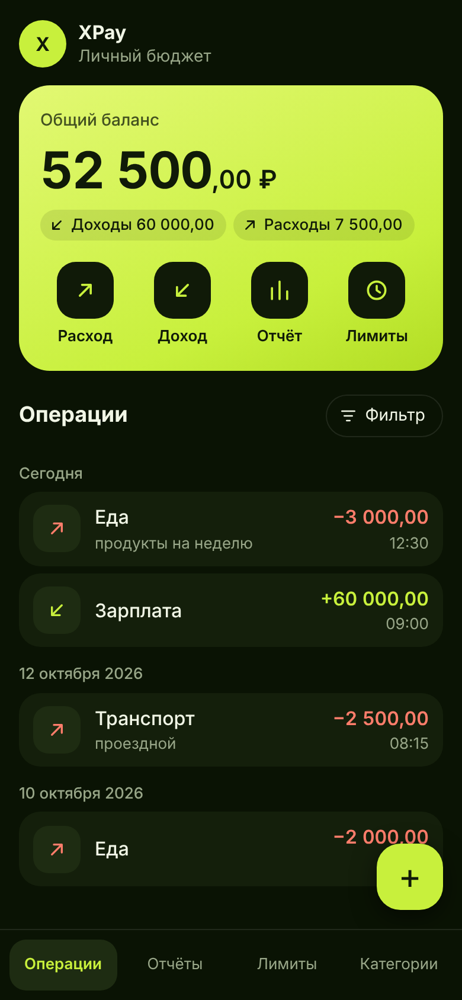

<!--
  Файл: README.md
  Назначение: описание проекта: что умеет программа, как её собрать на macOS
  и в Visual Studio, как запустить тесты и мини-приложение Telegram.
-->

# XPay: финансово-экономический советник

Консольная программа на C++17 для учёта личных финансов: операции по категориям, статистика за период, месячные лимиты и прогноз накоплений. Данные хранятся в файле JSON. Поверх той же логики сделано мини-приложение Telegram: ядро на C++ собрано в WebAssembly, и страница вызывает его вместо собственных расчётов.

Главное меню:

```
=== Финансово-экономический советник ===
1. Показать все операции
2. Добавить операцию (Доход/Расход)
3. Анализ и отчеты
4. Настройки бюджетных лимитов
---
5. Выход
Выберите пункт:
```

Список операций и статистика за период:

```
№  Дата        Время  Тип     Категория    Сумма, руб.  Описание
5  20.10.2026  21:00  Расход  Развлечения    -5 000,00
4  12.10.2026  08:15  Расход  Транспорт      -2 500,00  проездной
3  10.10.2026  19:00  Расход  Еда            -2 000,00
2  03.10.2026  12:30  Расход  Еда            -3 000,00  продукты на неделю
1  01.10.2026  10:00  Доход   Зарплата      +60 000,00
Итого: доходы 60000 руб., расходы 12500 руб., баланс 47500 руб.
```

```
Финансовый отчёт с 01.10.2026 по 31.10.2026

Доходы:  60000 руб.
Расходы: 12500 руб.
Баланс:  47500 руб.

Расходы по категориям:
Еда: [#######] 40% (5000 руб.)
Развлечения: [#######] 40% (5000 руб.)
Транспорт: [####] 20% (2500 руб.)
```

## Что умеет

**1. Показать все операции.** Таблица от новых операций к старым и подменю:

- фильтр по периоду, категории и типу;
- редактирование: программа спрашивает каждое поле, Enter оставляет прежнее значение;
- удаление с подтверждением «д/н».

**2. Добавить операцию.** Программа спрашивает по очереди:

- тип: `1` доход, `2` расход;
- сумму: `1500`, `1500,50` или `1 500.5`, не больше двух знаков после запятой;
- категорию: номер из списка;
- дату в виде `05.11.2026` и время в виде `09:30`. Enter подставляет текущие;
- описание, его можно пропустить.

**3. Анализ и отчеты.**

- Статистика за период: доходы, расходы, баланс и расходы по категориям со шкалой. Enter вместо даты снимает границу периода.
- Финансовый прогноз: средний доход и расход в месяц, их разница («сберегаемый потенциал») и сколько накопится за 3, 6 и 12 месяцев.
- Экспорт отчёта в `.txt` или `.csv`. В CSV разделитель «;» и запятая в суммах, как ждёт русский Excel.

**4. Настройки бюджетных лимитов.** Список категорий расходов с лимитом и тратами за текущий месяц, установка и снятие лимита, добавление и удаление категорий. Когда новый расход выводит категорию за лимит, программа предупреждает:

```
Внимание: лимит на «Развлечения» превышен. Потрачено 12000,50 руб. из 10000 руб., перерасход 2000,50 руб.
```

**5. Выход.** Данные сохраняются в файл `finance.json` в той папке, откуда запущена программа, и читаются оттуда при следующем запуске. Другой файл можно указать первым аргументом: `./xpay семья.json`.

На неверный ввод программа отвечает, что именно не так, и спрашивает снова: «Введите число от 1 до 5», «Сумма пишется цифрами, после запятой не больше двух знаков», «День должен быть в диапазоне от 1 до 28».

## Сборка на macOS

Нужен только компилятор `clang++`. Он входит в инструменты командной строки Apple; если их нет, macOS предложит установить их при первом вызове компилятора.

1. Открыть «Терминал» и перейти в папку проекта.
2. Собрать программу:

```bash
clang++ -std=c++17 -Iinclude src/*.cpp app/main.cpp -o xpay
```

3. Запустить:

```bash
./xpay
```

### Вариант с CMake

CMake на Mac обычно ставят через Homebrew, поэтому сначала нужен сам Homebrew (brew.sh), затем `brew install cmake`. После этого:

```bash
cmake -S . -B build
```

```bash
cmake --build build
```

```bash
./build/xpay
```

## Сборка в Visual Studio

Нужна Visual Studio 2019 или новее с компонентом «Разработка классических приложений на C++».

1. Файл → Открыть → Папка, выбрать папку проекта. Visual Studio найдёт `CMakeLists.txt` и настроит сборку сама.
2. Дождаться в окне «Вывод» строки о том, что создание кэша CMake завершено.
3. В списке «Выбрать автозапускаемый элемент» на панели инструментов выбрать `xpay.exe`.
4. Нажать Ctrl+F5.

В `CMakeLists.txt` для компилятора Microsoft задан флаг `/utf-8`: исходники и строки программы записаны в UTF-8, и без флага русский текст выводится неверно. Саму консоль на UTF-8 программа переключает при запуске.

## Тесты

Сборка и запуск одной командой на macOS:

```bash
clang++ -std=c++17 -Iinclude -Itests src/*.cpp tests/*.cpp -o xpay_tests && ./xpay_tests
```

С CMake тесты собираются вместе с программой, запуск: `ctest --test-dir build`. В Visual Studio нужно выбрать автозапускаемый элемент `xpay_tests.exe`.

541 проверка без сторонних библиотек:

- суммы: разбор `1500`, `1 500,5`, отказ на буквы, ноль и три знака после запятой, наибольшая сумма;
- даты: 29 февраля в високосный и обычный год, 30 февраля, 24:00;
- операции: добавление, правка всех полей, удаление, фильтр с границами периода;
- отчёт: посимвольное совпадение со строками из задания, текстовый отчёт и CSV целиком;
- лимиты: трата ровно на лимит и превышение на одну копейку;
- прогноз: месяц без операций, смена года, расходы больше доходов;
- JSON и файл данных: запись и чтение дают исходное состояние, 16 видов испорченных данных отклоняются;
- меню: сценарии подаются строками вместо клавиатуры, в том числе буквы вместо цифр в каждом поле и обрыв ввода посреди действия.

## Мини-приложение Telegram



Страница в папке `miniapp` показывает те же данные и считает их тем же кодом. Файл `miniapp/wasm/xpay.wasm` собран из `src` (без консольного меню и работы с диском). Страница отправляет ему команды строками JSON: добавить операцию, получить список, отчёт, лимиты. На JavaScript написаны только экраны и сохранение.

В Telegram данные лежат в облачном хранилище (CloudStorage) и видны на всех устройствах пользователя, в обычном браузере хранятся в `localStorage`. Формат тот же, что у `finance.json`.

### Запуск на своём компьютере

Сборка не нужна, готовый `xpay.wasm` лежит в репозитории. Браузер не загружает модули с диска напрямую, поэтому нужен локальный сервер. На macOS он есть в Python из инструментов Apple:

```bash
python3 -m http.server 8000 --directory miniapp
```

Затем открыть `http://localhost:8000`. В Windows та же команда начинается с `py` вместо `python3`.

### Подключение к боту

Telegram открывает мини-приложение только по адресу с HTTPS. Сценарий `.github/workflows/pages.yml` выкладывает папку `miniapp` на GitHub Pages.

1. На странице репозитория открыть Settings → Pages и в поле Source выбрать GitHub Actions.
2. Во вкладке Actions выбрать «Тесты и публикация мини-приложения» и нажать Run workflow. Дальше сценарий запускается сам после каждого изменения в `main`.
3. Проверить, что страница открывается: `https://olsh2zz.github.io/Financial-and-Economic-Advisor/`.
4. В Telegram написать боту @BotFather команду `/newbot`, задать имя и адрес бота.
5. Там же: `/mybots` → выбрать бота → Bot Settings → Menu Button → Configure menu button. Отправить адрес из шага 3 и подпись кнопки, например `XPay`.
6. Открыть чат с ботом: слева от поля ввода появится кнопка, она запускает приложение.

Токен бота для этого не нужен, и в репозитории его быть не должно.

### Тесты и пересборка ядра

Тесты связки JavaScript с ядром запускаются в Node.js 20 или новее (на Mac ставится установщиком `.pkg` с nodejs.org):

```bash
npm test
```

Они загружают `xpay.wasm` и проверяют ответы на команды, кириллицу и эмодзи в описаниях, сохранение по частям и 3000 операций подряд.

После правок в `src` или `include` модуль нужно пересобрать. Для этого нужен компилятор Emscripten (emscripten.org):

```bash
bash tools/build_wasm.sh
```

## Как это работает

Суммы хранятся целым числом копеек. В дробных числах `0,1 + 0,2` не равно `0,3`, а в копейках такой ошибки нет.

Дата и время операции записаны строкой вида `2026-11-12T09:30`. Такие строки сравниваются как текст, и порядок совпадает с порядком по времени, поэтому для фильтра и сортировки дату не нужно разбирать.

Доля категории равна её расходам, делённым на все расходы за период, с округлением до целого процента. Длина шкалы взята из образца в задании: 40% занимают 7 решёток, остальные значения считаются в той же пропорции.

Лимит действует на календарный месяц операции. Потратить ровно сумму лимита можно, предупреждение появляется с первой копейки сверх него.

Прогноз делит все доходы и все расходы на число календарных месяцев от первой операции до последней. Месяц без операций тоже входит в счёт.

JSON читает и пишет собственный модуль `json.cpp` (около 420 строк), сторонних библиотек в проекте нет. Он понимает объекты, массивы, строки и целые числа; дробные не нужны, потому что суммы хранятся в копейках. При чтении файла проверяется каждое поле. Если файл испорчен, программа сообщает об этом и завершает работу, а не затирает его пустыми данными. Запись идёт во временный файл с последующим переименованием.

Расчёты отделены от ввода и вывода. Класс меню `App` получает потоки и «текущее время» через конструктор, поэтому тесты проходят по меню без клавиатуры и не зависят от даты запуска. Ошибки передаются значением (`Result`, `Status`), исключений в ядре нет: так оно собирается в WebAssembly без поддержки исключений.

Облачное хранилище Telegram принимает значения не длиннее 4096 символов, поэтому страница режет текст состояния на части по 3500 символов и собирает их при чтении.

## Структура проекта

| Файл | Что в нём |
| --- | --- |
| `include/xpay/*.hpp` | Объявления с описанием каждой функции |
| `src/money.cpp` | Разбор и вывод сумм |
| `src/datetime.cpp` | Проверка и разбор дат и времени |
| `src/text.cpp` | Строки в UTF-8: длина в символах, регистр, выравнивание |
| `src/model.cpp` | Операция, состояние, категории первого запуска |
| `src/ledger.cpp` | Операции и категории, фильтр |
| `src/report.cpp` | Итоги, доли, шкала, экспорт в текст и CSV |
| `src/budget.cpp` | Лимиты и прогноз |
| `src/json.cpp` | Чтение и запись JSON |
| `src/storage.cpp` | Состояние в JSON и обратно с проверкой |
| `src/file_store.cpp` | Файл данных и файлы экспорта |
| `src/app.cpp` | Консольное меню |
| `src/console.cpp` | UTF-8 в консоли Windows |
| `src/api.cpp` | Команды ядра для мини-приложения |
| `app/main.cpp` | Точка входа консольной программы |
| `wasm/wasm_main.cpp` | Точка входа модуля WebAssembly |
| `tools/build_wasm.sh` | Сборка `xpay.wasm` |
| `tests/*.cpp` | Тесты C++ |
| `tests/js/` | Тесты мини-приложения |
| `miniapp/index.html`, `miniapp/css/style.css` | Разметка и оформление |
| `miniapp/js/app.js` | Экраны и обработка ввода |
| `miniapp/js/core/engine.js` | Загрузка `xpay.wasm` и передача команд |
| `miniapp/js/core/storage.js` | Запись в хранилище по частям |
| `miniapp/js/platform/telegram.js` | Обёртка над Telegram WebApp API |
| `miniapp/wasm/xpay.wasm` | Собранное ядро |

## Что не проверено

- Сборка и тесты проходили на Linux компиляторами GCC 13 и Clang 18, в том числе под AddressSanitizer и UndefinedBehaviorSanitizer (утечек и ошибок памяти нет). На macOS и в Visual Studio проект не собирался.
- В консоли Windows ввод русских букв с клавиатуры (описание операции, название категории) зависит от версии Windows. Выбор в меню и суммы вводятся цифрами и от этого не зависят.
- Мини-приложение проверено в браузере Chromium. В самом Telegram оно не запускалось.
- Если открыть мини-приложение на двух устройствах одновременно, сохранится состояние того, которое записало последним.
- Скачивание файла отчёта во встроенном окне Telegram зависит от клиента. На этот случай текст отчёта можно скопировать.
